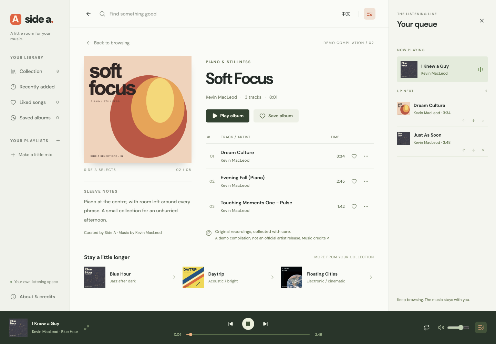
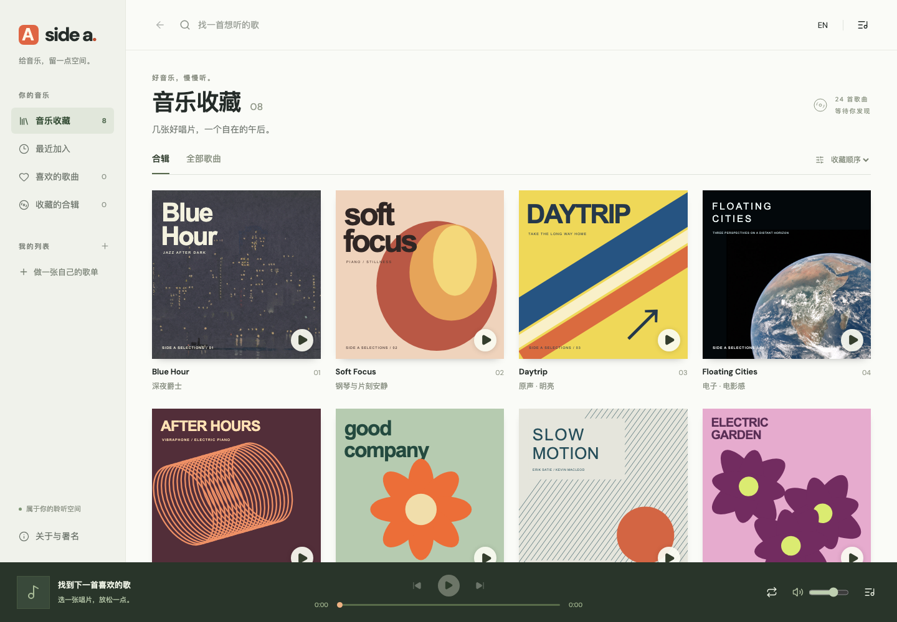

# Side A

A little room for your music. **Side A** is a local music library with eight
authored demo compilations, 24 full recordings and a persistent player.

[Run and test](../README.md) · [Design](DESIGN.md) · [Assets](ASSETS.json) · [Evidence](EVIDENCE.md)



## Try this

1. Open **Blue Hour** and play **I Knew a Guy**, the second track.
2. Go back, search **Soft**, and open **Soft Focus**. The bottom player still
   identifies Blue Hour; the music continues.
3. In Dream Culture's `•••` menu, choose **Play next**. Add Evening Fall (Piano)
   to the end. Open the queue and change their order with the arrow buttons.
4. Open the listening view from the bottom artwork. **Back to where you were**
   returns to the same browsing object and scroll position.
5. Like a song, save the compilation, and use a song's menu to make a playlist.
   Rename it, add another occurrence of a song, and reorder or remove entries.
6. Pause, move the progress control, and reload. Likes, playlists, queue,
   current occurrence and position return. Press Play to resume; reopening is silent.

The top search covers songs, artists/composers and compilation titles. Clearing
search returns to its originating view and position. Sorting the library does
not reorder an already established playback queue. Original titles and credits
are retained in both UI languages.

## Playback and saving

- Playing an album or track establishes that visible list as the queue.
  Playing a track begins at its position in that list.
- **Play next** inserts immediately after the current occurrence. **Add to end**
  appends. With an empty queue, either action prepares a paused first item.
- Duplicate tracks are separate occurrences. Only upcoming entries have move
  and remove controls. The current song and history remain stable.
- The mode control cycles through **In order**, **Repeat queue**, and
  **Repeat track**. Repeat track affects natural ending; Next still advances.
  In order stops at the queue's final item. Previous restarts after three
  seconds, otherwise goes to the preceding item.
- Seek, time and playback status use the real audio element. A rejected play
  request or bad recording leaves the identity visible with a retry action.
- Volume appears where the browser accepts programmatic volume. It is also
  available inside the listening view on narrow screens.
- This browser stores the library under `fc.side-a.v1`. Changes and pauses
  save immediately; elapsed playback saves at most once per 2.5 seconds.
  There is no cross-browser/cloud synchronization.
- If saving fails, the page labels changes as **only in this tab**, preserves
  them, and offers retry/export. A damaged or unknown-version save is never
  silently overwritten. Missing catalog entries can be repaired explicitly,
  with the original export available first.
- **About & credits** includes JSON export/import and a confirmed reset of this
  app's key only. Preview first, then merge while listening or explicitly restore
  a backup paused. See the [transfer rules](../README.md#library-transfer). Other
  applications' storage is not cleared.

No account, streaming API, paid service, upload, personal-audio import, lyrics or recommendation
backend is represented by an inactive control. Prepare local media explicitly with `npm run media:fetch`; audio binaries are
not included in Git. Only the selected recording is requested for playback.

## Music, pictures and type

All 24 recordings are by **Kevin MacLeod (incompetech.com)** under
[Creative Commons Attribution 4.0](https://creativecommons.org/licenses/by/4.0/).
The three Gymnopédies were composed by Erik Satie. Each song's original title,
ISRC and source URL is in the [catalog](fixtures/catalog.json), and the in-app
credits link all 24 recordings. Full MP3 recordings were transcoded to AAC at
96 kb/s without trimming. These are synthetic compilations, not official
releases by the musician.

The cover arrangements are by Faye & Cove. Blue Hour incorporates Joseph
Pennell's drawing *Night lights of Manhattan*, c. 1921–1926, from the
[Library of Congress](https://www.loc.gov/item/2003663794/), whose item record
states no known publication restrictions. Floating Cities incorporates the
[Apollo 17 Blue Marble](https://svs.gsfc.nasa.gov/30613/) photograph by the crew,
NASA Johnson Space Center, under [NASA's media guidelines](https://www.nasa.gov/nasa-brand-center/images-and-media/).
Neither artist nor institution endorses the app.

DM Sans is bundled with its [OFL](public/assets/fonts/OFL.txt); Chinese uses the
platform font stack. React and Lucide notices are retained in the
[runtime notices](public/THIRD-PARTY-NOTICES.txt). The
[asset manifest](ASSETS.json) preserves individual rights; project licenses
do not replace them.

## 中文使用

Side A 把**正在看的收藏**与**正在听的曲目**留在各自清楚的位置。八组示范合辑、24 首
完整音乐可通过明确的准备命令下载到本地。顶栏切换语言，封面、曲目原题、作者与正在进行的聆听保持不变。

可以先播放 Blue Hour 的第二首，再去 Soft Focus 把 Dream Culture 加入下一首。
在队列里调整之后进入聆听空间，再点“回到刚才的位置”。喜欢、合辑收藏和个人列表
都会保存；刷新后恢复队列和进度，始终暂停。关于页提供完整署名、JSON 导出／导入与仅重置此应用的入口。导入可保留当前聆听并合并，也可确认后暂停恢复整份备份。



## Continue making

The [project catalog](catalog.json) connects the operated browsing/listening and
file-preview/commit relationships to captured states, exact source, authored
covers and the local typeface. It is a practiced product candidate, not an
owner-approved style or evidence of autonomous FC performance. From the repo root:

```bash
python3 scripts/fc_catalog.py query --catalog examples/products/music-library/catalog.json --task library-transfer
python3 scripts/fc_catalog.py resolve --catalog examples/products/music-library/catalog.json --root fc-side-a:package=examples/products --id library-continuation
python3 scripts/fc_catalog.py gallery --catalog examples/products/music-library/catalog.json --root fc-side-a:package=examples/products --out examples/products/music-library/gallery
```

The gallery is generated; edit `src/` and capture a new visible revision rather
than patching it. Catalog recipes describe how to run; resolving never executes
source or fetches audio.
