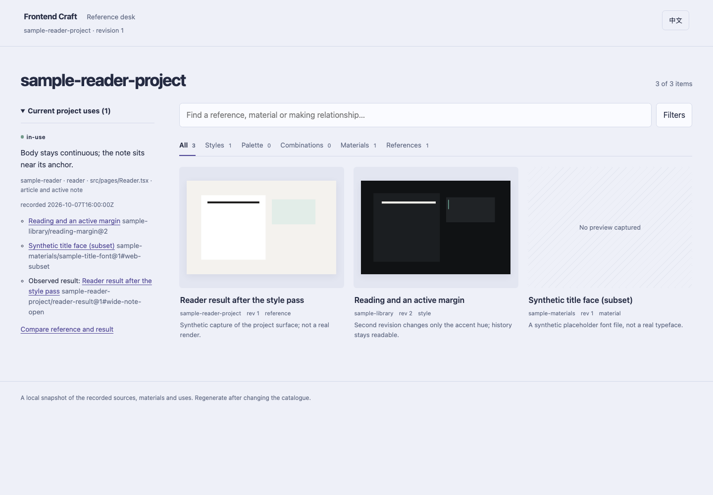

# Reference desk: a project that can be reopened

This is an actual project catalogue for FC's generated reference tool. It links
the canonical UI source, a practiced collection/context/return relationship,
the palette as it appears in use, eight real browser captures, and one observed
project use. The pictured records come from the explicitly **synthetic**
`examples/catalog/` fixture. The interface was rendered and operated; its
sample reader and font records are invented.

This is a technical product example and a reusable interaction mechanism.
It is not an endorsed visual style, an expressive showcase, a user study, or
evidence that FC improves autonomous design quality. No personal records or
external artwork are included.



## Open the project record

From the repository root, with Python 3:

```bash
python3 scripts/fc_catalog.py validate \
  --catalog examples/reference-desk/catalog.json \
  --root fc-reference-desk:package=.
python3 scripts/fc_catalog.py gallery \
  --catalog examples/reference-desk/catalog.json \
  --root fc-reference-desk:package=. \
  --out examples/reference-desk/gallery
python3 -m http.server 4182 --bind 127.0.0.1
```

Open [the project gallery](http://127.0.0.1:4182/examples/reference-desk/gallery/).
The generated directory is ignored and rebuildable. It is a static local view;
generating it does not start a server, upload material, or execute the recorded
source. No Node package is required to generate or browse it.

Start at **Current project uses**, follow its exact source, then return. Open
the collection/context/return item to see the actual states and its limits.
Follow the palette's instance link into the same record. Search, choose a role,
open a historical version when present, and compare two records. Reload and
browser Back preserve the selected identities and filters; Back/Escape restore
the live origin's focus and position. UI language changes leave record text and
the current comparison intact. Compact screens fold secondary adoption details
behind a keyboard-accessible disclosure.

Resolve the observed use as a file bundle:

```bash
python3 scripts/fc_catalog.py resolve \
  --catalog examples/reference-desk/catalog.json \
  --root fc-reference-desk:package=. \
  --id reference-desk-navigation
```

This returns the use's own `in-use` status separately from file resolution, the
exact CSS/JS files it adopted, and the captured result. No recipe is executed.
A moved checkout can bind `fc-reference-desk:package` to the new package root.
Missing or changed source files remain explicit rather than resolving to a
different version.

## Replay the browser contract

The reusable browser callback exercises the small synthetic project fixture,
not this documentation catalogue. Generate it into a temporary directory:

```bash
python3 scripts/fc_catalog.py gallery \
  --catalog examples/catalog/project/catalog.json \
  --with-catalog examples/catalog/library/catalog.json \
  --with-catalog examples/catalog/materials/catalog.json \
  --out /tmp/fc-catalog-replay
python3 -m http.server 4183 --bind 127.0.0.1 --directory /tmp/fc-catalog-replay
```

With a configured Playwright CLI, open that page and run the callback from the
repository root in a second terminal:

```bash
playwright-cli -s=fc-catalog open http://127.0.0.1:4183/
playwright-cli -s=fc-catalog run-code "$(cat tests/browser/catalog.js)"
playwright-cli -s=fc-catalog close
```

Use the host's installed CLI or its supported wrapper. The callback requires no
`@playwright/test` project. It exercises filtering, deep links, exact history,
material download, comparison, reload, keyboard return, language, compact
disclosure and overflow; failures throw. The offline `scripts/check` separately
checks catalogue contracts and browser-source syntax. It does not launch a
browser or establish visual quality.

## Source and capture ownership

- [UI CSS](../../assets/catalog/gallery.css) and [UI JavaScript](../../assets/catalog/gallery.js)
  are the canonical interface source. The generator inlines them into the
  single HTML entry before publishing it atomically.
- [The catalogue](catalog.json) preserves source identities, the observed use,
  capture conditions, digest checks and making limits. The screenshots are
  derived captures of the actual generated fixture, without browser chrome.
- After a visible UI change, regenerate the fixture, inspect both languages at
  1440×1000 and 390×844, retain new captures as a new catalogue revision, and
  update source digests. Do not overwrite a published historical capture.
- Functional source/catalogue records use SUL-1.0. This README and captures use
  CC BY-NC-SA 4.0; see [the rights map](../../LICENSING.md).

## 中文

这是 FC 参考工作台自身的真实项目 catalog：源码、实际配色、可复用的
“集合 → 准确上下文 → 返回”关系、八张真实浏览器截图和一次已观察到的采用。
画面里的阅读器与字体记录来自明确标注的合成 fixture；工具确实运行过，
图中示范项目不是真实用户项目。

先按上面的命令生成本地画廊，即可沿当前采用项进入准确源码、材料与结果，
返回原位置；也可以查看状态、并排比较、切换语言和刷新接续。
窄屏优先展示预览，采用详情可以用键盘展开。`resolve` 返回采用事实及其
文件，采用状态与解析状态分开；不会自动执行脚本或取得远端材料。

它是技术产品和交互机制的实践记录，不是审美认可、炫技作品、用户研究或
自主 FC 效果证明。图中的关系和配色只能继承这里实际核对过的范围；
换内容、媒介或产品以后，仍要重新检查整体。现有中文字体的真实样张和
准确原物／衍生物关系另见 [材料示例](../materials/README.md)。
